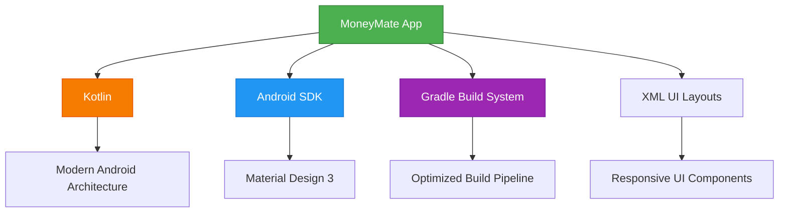

# 💰 **MoneyMate** - Personal Finance Tracker


> *Take control of your finances with **MoneyMate** - the simple, powerful, and privacy-focused expense tracking app that helps you build better spending habits.*

---

## 🌟 **Overview**

**MoneyMate** is a beautifully crafted Android application designed to simplify personal financial management. Built with modern Android development practices, it empowers users to effortlessly track expenses, analyze spending patterns, and maintain financial wellness—all while keeping your data completely private and secure on your device.

---

## ✨ **Key Features**


| 💸 **Expense Tracking** | 📊 **Smart Analytics** | 🎨 **Beautiful UI** |
|:---:|:---:|:---:|
| Add daily expenses instantly | Categorize and analyze spending | Clean, intuitive interface |
| Quick entry with smart suggestions | Visual insights and summaries | Light & Dark mode support |


### 🎯 **Core Capabilities**

- **📝 Effortless Expense Entry** - Add transactions in seconds with intuitive input forms
- **🏷️ Smart Categorization** - Organize expenses with customizable categories
- **📈 Insightful Analytics** - Visualize spending patterns with charts and summaries  
- **🌙 Adaptive Theming** - Seamlessly switch between light and dark modes
- **📱 Offline-First Design** - Full functionality without internet dependency
- **🔒 Privacy-Focused** - All data stays securely on your device

---

## 🛠️ **Technical Stack**





| Technology | Purpose | Version |
|------------|---------|---------|
| **Kotlin** | Primary language | Latest stable |
| **Android SDK** | Framework | API 21+ |
| **Gradle** | Build automation | 8.0+ |
| **XML** | UI layout design | AndroidX |

---

## 📁 **Project Architecture**

```
MoneyMate/
│
├── 📱 app/
│   ├── 📂 src/
│   │   ├── 📂 main/
│   │   │   ├── 🔧 java/               # Kotlin source files
│   │   │   │   ├── ui/                # Activity & Fragment classes
│   │   │   │   ├── data/              # Data models & repositories
│   │   │   │   ├── utils/             # Helper utilities
│   │   │   │   └── viewmodel/         # MVVM ViewModels
│   │   │   ├── 🎨 res/                # Resources & layouts
│   │   │   │   ├── layout/            # UI XML files
│   │   │   │   ├── values/            # Strings, colors, themes
│   │   │   │   ├── drawable/          # Icons & graphics
│   │   │   │   └── mipmap/            # App icons
│   │   │   └── 📄 AndroidManifest.xml # App configuration
│   │   └── 🧪 test/                   # Unit tests
│   └── 📋 build.gradle                # Module build config
│
├── ⚙️ gradle/                         # Gradle wrapper
├── 📋 build.gradle                    # Project build config
├── ⚙️ settings.gradle                 # Project settings
└── 📖 README.md                       # This file
```

---

## 🚀 **Getting Started**

### 📋 **Prerequisites**

Before diving in, ensure you have:

- **Android Studio** (Flamingo 2022.2.1 or later)
- **Android SDK** (API level 21+)
- **Java JDK** 8 or higher
- **Git** (for version control)

### 💻 **Installation Guide**

```bash
# 1️⃣ Clone the repository
git clone https://github.com/dhananjana10/money-mate.git

# 2️⃣ Navigate to the project directory
cd MoneyMate
```

**In Android Studio:**
1. 🎯 **Open Project** → Select the `MoneyMate` directory
2. ⏳ **Wait** for Gradle sync to complete
3. 🔌 **Connect** your Android device or start an emulator
4. ▶️ **Run** the app using the green play button

### 🔧 **Build Instructions**

```bash
# Generate debug APK
./gradlew assembleDebug

# Generate release APK (signed)
./gradlew assembleRelease

# Run tests
./gradlew test
```

📦 **APK Location:** `app/build/outputs/apk/debug/app-debug.apk`

---

## 📸 **Visual Preview**

> *Coming Soon: Screenshots showcasing MoneyMate's beautiful interface*

**Expected Screenshots:**
- 🏠 **Home Dashboard** - Overview of recent transactions
- ➕ **Add Expense** - Simple expense entry form  
- 📊 **Analytics** - Spending insights and charts
- ⚙️ **Settings** - Customization options
- 🌙 **Dark Mode** - Elegant dark theme showcase

📂 **Screenshot Path:** `app/src/main/res/screenshots/`

---

## 🛡️ **Privacy & Security**


### 🔒 **Your Data, Your Device**


> **MoneyMate** is built with privacy as a fundamental principle. We believe your financial information should remain **exclusively yours**.

- ✅ **No Data Collection** - Zero personal information gathering
- ✅ **Offline-First** - Full functionality without internet access  
- ✅ **Local Storage Only** - All data stays on your device
- ✅ **No Third-Party Analytics** - No tracking or profiling
- ✅ **Open Source** - Transparent, auditable codebase

---

## 🤝 **Contributing**

We welcome contributions! Here's how you can help:

1. **🍴 Fork** the repository
2. **🌿 Create** a feature branch (`git checkout -b feature/amazing-feature`)
3. **💾 Commit** your changes (`git commit -m 'Add amazing feature'`)
4. **📤 Push** to the branch (`git push origin feature/amazing-feature`)
5. **🎯 Open** a Pull Request

### 📝 **Code Style**
- Follow [Kotlin coding conventions](https://kotlinlang.org/docs/coding-conventions.html)
- Use meaningful variable and function names
- Add comments for complex logic
- Include unit tests for new features

---

## 📄 **License**


**MIT License** © 2024 MoneyMate

*This project is open source and available under the [MIT License](LICENSE).*

**Freedom to use, modify, and distribute** 🎉


---


### 💝 **Built with ❤️ for the community**

*Help us improve MoneyMate by sharing feedback, reporting issues, or contributing code!*

**⭐ Star this repo** if MoneyMate helps you manage your finances better!

---


